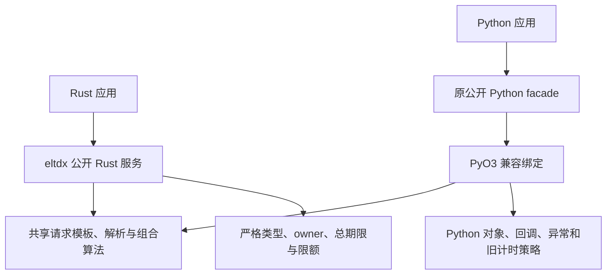

# T23：F10、离线文件、财报与组合迁移索引

本页记录源码范围及兼容边界。T23 实现、绑定、用例、消费者源码和映射已写完；全部编译、测试、安装、网络、平台和打包验收仍按用户要求延期到 T01–T30 实现全部写完后进行。这里的“源码完成”不能当作已验证可用。

## 两个独立入口

Rust 用户依赖 `eltdx` crate，按功能启用 `f10`、`offline`；调用不经过 Python。Python 用户继续安装 Python 包，使用原来的公开方法和 Python 模型；发行 wheel 内的原生模块调用共享 Rust 实现。普通 wheel 消费环境无需 Rust 工具链。是否满足这些安装承诺由 T28/T29 的独立环境执行证据确认。

Python 的 `params/call`、HTTP、自定义资源客户端、Path、Struct、解析器、字段字典和模型构造仍是兼容扩展面。绑定负责动态对象调用与旧策略投影，不把 Python 用户的行为强行替换成严格 Rust 的默认值。

## 功能和实现归属

| 能力 | Rust 实现 | Python 原生适配 | feature |
| --- | --- | --- | --- |
| 157 个 F10 公开入口 | `f10/endpoints/` 请求与具名 query、`f10/client.rs` | `f10_request/report/object/collection.rs` | `f10` |
| 动态结果、字段、新闻、模型属性 | `f10/response.rs`、`collection.rs`、`fields.rs`、`news.rs` | `f10_response/fields/news/values/models.rs` | `f10` |
| 历史日资金流 | `services/money_flow_history.rs` | `money_flow_history.rs` | `f10` |
| 四个集合 helper | `helpers/f10.rs`、typed market collectors | `helper_f10.rs`、`f10_collection.rs` | `f10` |
| 个股题材及题材成分 | `helpers/topics.rs` | `helper_topics.rs` | `f10` |
| 题材强度排名 | `helpers/theme.rs`、HQ ladder | `helper_theme.rs` | `f10` |
| 本地文件、日线/分钟/EX 日线、写入、GBBQ、板块 | `offline/` | `offline_paths/bars/write/gbbq/blocks.rs` | `offline` |
| 财报列表、DAT、ZIP、本地与 HQ 下载 | `offline/financial.rs`、`financial.rs`、共享资源下载 | `offline_financial.rs` | `offline` |

表中的绑定文件均位于 `crates/eltdx-python/src/`；Rust 实现路径相对 `crates/eltdx/src/`。默认 HQ-only helper 保持默认 feature 可用。F10 helper 缺少 `f10` 时不暴露该方法，不通过 Python 或另一传输在运行时补齐。

## 必需与可选来源

| 组合 | 来源与次序 | 失败和结果政策 |
| --- | --- | --- |
| index_members / index_etfs / board_members / ipo_calendar | 各自 F10 单次或分页来源 | 保留 typed collection 完成状态和原 Response；传输、协议、取消及期限错误终止，不连接 HQ |
| stock_topics | topic_ids，然后 hot_topics | 两源均请求；传输失败不交付部分成功。业务状态保存在 `responses/ok`；按首次发现次序合并，同源末行 raw 与 hot 覆盖规则保留 |
| topic_stocks | 仅显式 ID 时直接 compare；名称/first 选择先解析 topic_ids+hot_topics | ID 匹配优先于名称；解析业务失败或没有匹配明确报错；compare 保留行序、原始行、未知 identity 和业务状态 |
| theme_strength_rank | 完整 HQ ladder，然后逐证券 F10 题材 | ladder 为必需源。普通题材失败按证券保留 result/error/diagnostic；取消、关闭、限额、内部错误或父期限耗尽终止 |
| money_flow.history / range | 单个 7615 zjlx_sj 请求 | 不切换到 7709 daily/category22；先反转，再 start/count 截取，绝不按日期排序 |
| 下载财报 records | HQ 文件列表、ZIP 文件、选中 DAT | EOF 与结构完整性分别确认；截断/限额不能当作完整结果；保留每层 source/raw |

Rust 跨源请求共用一个父 operation：owner admission、绝对总期限、取消和工作预算贯穿所有前置请求、分页、解码与投影。`TdxClient` 与其 F10 句柄共享关闭状态；独立创建的 `F10Client` 保持自己的 owner。纯 F10 组合不启动 HQ。

题材排名读取完整 ladder 后才聚合，全部题材处理完后稳定按数量、最高连板、连板股数量和封单额降序，再应用 top-N。并列保留首次发现次序；同级龙头保留首次最高级。严格 Rust 金额要求有限、非负且确认 CNY；Python 保留原数值运算和 round6。

## Python 必须保留的行为

| 范围 | 兼容要求 |
| --- | --- |
| 请求与生命周期 | 原逐请求计时、弱 factory、executor context、自定义 params/call/HTTP 回调和异常 cause；原 getter 捕获/参数转换次序 |
| 身份与输入 | 原 BRK.B/HK 规范化、Unicode、任意精度整数、bool、非有限数、开放 selector 和 local date 默认行为 |
| 字段与模型 | 运行时字典与 notes、重复字段后缀/碰撞、原 row/raw identity、live constructor、lazy tuple、StopIteration 的原 cause、标准 dataclass |
| 集合与缓存 | 原 total 扫描、软分页上限、无进展结束、规范化缓存 key 与原 getter 参数、None miss、成功对象 identity、失败刷新保留旧缓存 |
| 题材 | 两源先 materialize 再合并、首次顺序/末行 raw、hot null 覆盖、ID 优先、延后 count 校验；可选 fetch 仅原 Exception 范围降级，迭代错误/BaseException 传播 |
| 历史资金流 | 完整 `tuple(reversed(response.rows))` 后切片；原对象与动态 split/str/tuple；raw 为原 kwargs 的紧凑 Unicode JSON 再 UTF-8 encode，区别于 Rust 实际 HTTP bytes |
| 本地文件 | 读取尾部、非法日期/raw bits、原 last-key 阈值、输入次序/重复、每日 flush/fsync、分钟/EX 原 close 策略和原路径异常 |
| 财报 | 原 first-distinct-DAT/ZipInfo、动态 int/re/date/codec/parser/model；直接 DAT 不新增严格总字节/重叠规则，ZIP 不新增全 archive 规则 |

自定义 Struct/layout/buffer/codec/parser 分支继续作为明确适配入口，源码索引列出范围和退出条件。仅在原生 callback 可以保留读取、求值、异常次序且最终差分用例通过后才能删除。Python 文件上下文、OS durability 和被动模型本身继续存在；这不要求 Rust 用户安装 Python。

## 证据索引与最终执行

迁移清单为 `tests/contracts/manifests/rust_sdk_migration.json`。T23 对 25 个 F10 catalog 项、3 个题材 helper 项补充 `authored_evidence`，并以 supplemental domain 记录国际/债券/行业期货、字段模型、集合 helper、历史资金流、offline 和财报。权威计数保持 26 wire / 25 registry / 124 capability / 37 static fixture；源码映射不会增加 capability 数，也不会把 `public_sdk_status` 或 `sdk_evidence` 提升为通过。

| 用例源码 | 待最终执行证明的内容 |
| --- | --- |
| `tests/test_native_f10_contract.py` | 原入口 wire 值、全部分支、字段/模型、动态 hook 与精确异常 |
| `tests/test_native_f10_helpers_contract.py` | 缓存、题材合并/选择、强度排序、可选失败与 lazy 对象 |
| `tests/contracts/test_sdk_money_flow_history_bridge.py` | 参数/constructor 捕获、完整反转、私有切片、raw 和错误次序 |
| `tests/test_native_offline_contract.py` | 路径、各类 bar/append、GBBQ、blocks、模型及自定义对象 |
| `tests/test_native_financial_contract.py` | DAT/ZIP/本地/HQ 组合、原限额、parser/model/exception hooks |
| `crates/eltdx/tests/f10_*.rs`、`helpers.rs` | 具名入口 HTTP、字面量请求清单、typed 结果、owner/预算/失败 |
| `crates/eltdx/tests/offline_*.rs`、`gbbq.rs`、`financial*.rs` | 文件、位级保真、ZIP、HQ 资源、完整性及取消/期限 |

独立 Rust consumer 的 `f10` 模式只依赖 std + eltdx，实际发送六个字面量期望 HTTP 请求，覆盖 generic/named/index/topics/compare、raw/status、共享关闭和 HQ 不启动。`offline` 模式覆盖 daily roundtrip/append/tail 和 industry；`financial` 模式用手写 ZIP/DAT 经过真实 HQ list/archive 下载。单文件 wheel consumer 用 stdlib 和已安装公开包提供对应覆盖，并保留 forbidden-root/no-toolchain 和产物 hash 证据入口。

消费者源码位于 `tests/consumers/rust-sdk/` 与 `tests/consumers/python-wheel/`，其 README 给出最终阶段命令。仍须复制到仓库外，在无 Python 的 Rust 环境和无 Rust 构建工具的 wheel 环境分别执行，记录源码 SHA、工具链、feature、平台、产物和日志 hash。源码 path consumer 不足以证明包内容或平台支持。

只有全部 T01–T30 实现完成后才运行验证，包括 `tests/contracts/test_command_registry_consistency.py` 中的迁移清单验证、Rust feature/MSRV/platform/package 矩阵、Python 回归/差分和独立消费者。真实线上协议、样本缺口与实验能力单列，不能用合成 loopback 成功替代。

## 后续工作

T19 的依赖解析/API/MSRV/TLS/平台验收仍未执行；T24/T25 的 EX/MAC owner/session/transport、T26 组合目录、T27 Python 扩展迁移以及 T28–T30 打包/交付/最终验证继续按原开发计划推进。T23 的源码范围完成不表示整个项目已完成。
